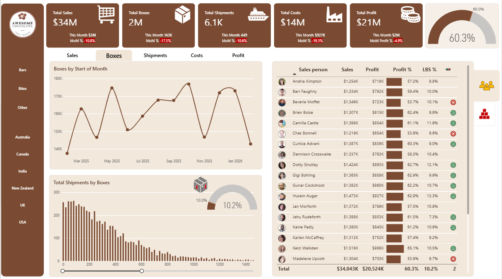
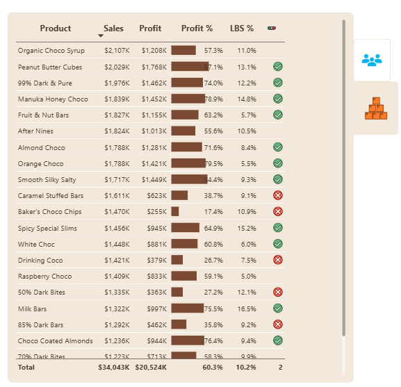
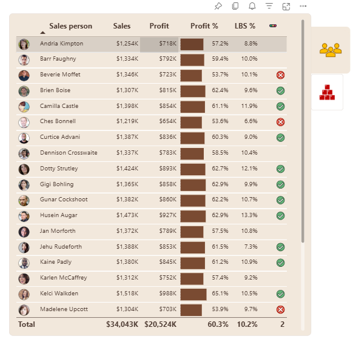

# Chocolate Sales Analytics Dashboard | Power BI

## Project Overview

This project presents an interactive Chocolate Sales Analytics Dashboard built using Microsoft Power BI. It analyzes sales performance, profitability, product performance, shipment activity, and salesperson performance using a sample chocolate sales dataset.

The dashboard provides a consolidated view of key business metrics and helps users explore sales trends, compare products, and evaluate business performance over time.

## Tools and Technologies

* **Power BI Desktop** — Dashboard development and data visualization
* **Power Query** — Data preparation and transformation
* **DAX (Data Analysis Expressions)** — Measures, KPIs, and time-based calculations
* **Microsoft Excel** — Source dataset

## Business Objectives

* Monitor overall sales, profit, costs, and shipment performance.
* Analyze monthly sales trends and month-over-month changes.
* Identify products with high sales and profitability.
* Compare salesperson performance using sales, profit, and profit percentage.
* Understand shipment volumes and box distribution.
* Provide an interactive dashboard for business performance analysis.

## Dashboard Features

### 1. Key Performance Indicators (KPIs)

The dashboard includes the following key metrics:

* Total Sales
* Total Boxes
* Total Shipments
* Total Costs
* Total Profit
* Profit Percentage
* LBS Count and LBS Percentage

### 2. Sales Trend Analysis

* Monthly sales performance over time.
* Month-over-month sales comparisons.
* Identification of changes in sales performance across months.

### 3. Product Performance Analysis

* Product-wise sales and profit comparison.
* Profit percentage by product.
* LBS percentage by product.
* Identification of products with relatively strong or weak performance.

### 4. Salesperson Performance Analysis

* Sales and profit by salesperson.
* Profit percentage comparison.
* LBS percentage comparison.
* Profit target indicators to support performance evaluation.

### 5. Shipment Analysis

* Shipment volume analysis.
* Distribution of shipments by boxes.
* Analysis of shipment activity across the dataset.

### 6. Interactive Reporting

* Interactive Power BI visuals.
* Data filtering and cross-visual exploration.
* KPI cards, tables, and charts for business reporting.

## Data Preparation and Analysis

The project uses an Excel sample dataset as its data source. Power Query is used for data preparation, while DAX is used for calculated measures and performance analysis.

The report covers a date range from **February 2025 to February 2026**, as represented in the exported dashboard.

**Note:** The dataset is for sample/project analysis. The displayed dates should not be interpreted as verified real-world business results.

## Dashboard Preview

The repository includes screenshots and a PDF export for quick viewing.

### Dashboard Overview

### Product Analysis

### Salesperson Analysis

## Project Files

| File                                                             | Description                                       |
| ---------------------------------------------------------------- | ------------------------------------------------- |
| [Dashboard PDF](documents/Chocolate_Sales_Dashboard.pdf)         | Static dashboard export for quick viewing         |
| [Power BI Report (.pbix)](report/Chocolate_Sales_Dashboard.pbix) | Power BI project file for interactive exploration |
| [Excel Dataset](data/ac-sample-data.xlsx)                        | Source dataset used for the analysis              |
| [Dashboard Screenshots](screenshots/)                            | Images showing the dashboard and its analysis     |

## How to Explore the Project

1. View the dashboard screenshots in the `screenshots` folder.
2. Open the PDF export to review the dashboard without Power BI Desktop.
3. Download the `.pbix` file and open it in Microsoft Power BI Desktop to explore the report.
4. Refer to the Excel dataset to understand the source data used in the project.

## Skills Demonstrated

* Data cleaning and preparation
* Data visualization and dashboard design
* KPI development and business reporting
* DAX measures and calculations
* Monthly trend and performance analysis
* Product and salesperson performance analysis
* Working with Excel data in Power BI
* Presenting business insights through interactive reports

## Key Business Questions

* How are sales and profits changing month over month?
* Which products generate higher sales and profit?
* Which products have comparatively lower profit margins?
* How does salesperson performance vary?
* What is the relationship between shipment activity and boxes shipped?
* Which KPIs should be monitored to evaluate overall business performance?

## Conclusion

This project demonstrates the use of Power BI to transform a sample sales dataset into an interactive business intelligence dashboard. It brings together sales, profitability, product, salesperson, and shipment metrics to support exploratory analysis and data-driven decision-making.
